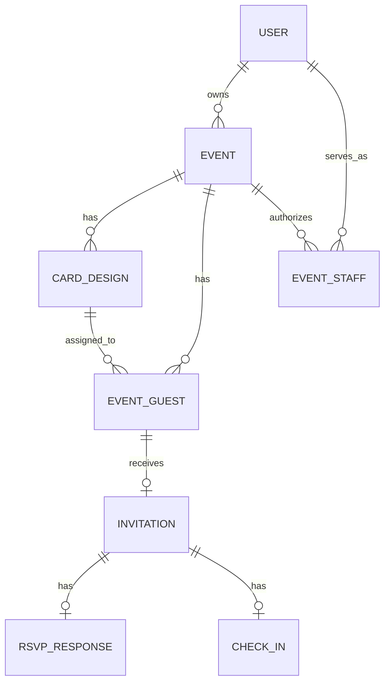

# SmartInvite — Event / Card / Guest / Invitation Domain Contract

**Version:** 2.0 — 2026-10-16. **Trạng thái:** authoritative business specification.  
Đọc kèm `CODEX_PLAN.md`, `FE_SCREEN_SPEC.md`, `AGENTS.md`. Nếu file demo cũ mâu thuẫn, ưu tiên spec này. Không tự thay đổi cấu trúc nghiệp vụ đã chốt.

## A. Mô hình trung tâm



Terminology:
- **User / Host**: chủ tài khoản; có thể tạo nhiều event; `ADMIN` cũng là user, không mặc định được đọc dữ liệu khách của event không thuộc sở hữu.
- **Event**: nguồn sự thật cho tên, ngày giờ, timezone, địa chỉ, map, RSVP deadline, trạng thái, danh sách khách và báo cáo. Ví dụ *Lễ tốt nghiệp*.
- **CardTemplate**: mẫu thiết kế dùng lại; có thể là template built-in tĩnh trong mã nguồn ở MVP. Không phải lời mời đã gửi.
- **CardDesign**: **một phiên bản thiệp thuộc đúng một Event**. Cùng event có thể có A (Gia đình), B (Bạn bè), C (Thầy cô). Chứa theme, bố cục, nội dung chung, hiệu ứng; có lifecycle DRAFT/PUBLISHED/ARCHIVED. Không lưu danh sách khách bên trong JSON của card.
- **EventGuest** (`guests` trong DB cũ): người được mời trong phạm vi đúng một event. Cùng một người xuất hiện ở hai event sẽ là hai `guests` độc lập trong MVP. Khách **không** bắt buộc có user account.
- **GuestCardAssignment**: mỗi guest có `card_design_id` thuộc cùng event; ban đầu có thể null trước khi phát hành; sau khi tạo link đang hoạt động thì phải gán một design đã PUBLISHED.
- **GuestPersonalization**: override cho **riêng khách**: cách xưng hô, lời nhắn, màu nhấn, ảnh (nếu bật). Không thể ghi đè ngày giờ/địa điểm hay RSVP deadline của event. Lưu JSON an toàn có schema whitelist/version.
- **Invitation**: một link mời đang hoạt động cho một guest ở một event; bearer token chứng thực quyền xem/RSVP trong phạm vi guest đó. Link **không** xác nhận danh tính thật. Trong MVP tối đa một invitation record cho mỗi guest (theo UNIQUE `invitations.guest_id`).
- **RSVPResponse**: trạng thái YES/NO của invitation, không gắn trực tiếp với card. PENDING = chưa có row RSVP.
- **CheckIn**: ghi nhận đã đến, độc lập RSVP và độc lập mẫu thiệp, duy nhất theo invitation.

**Quan hệ không được làm sai:** `User 1:N Event`; `Event 1:N CardDesign`; `Event 1:N Guest`; `CardDesign 1:N Guest`; `Guest 0..1 Invitation`; `Invitation 0..1 RSVP`; `Invitation 0..1 CheckIn`.

## B. Bất biến nghiệp vụ (MUST)

**BR-01** Không có CardDesign mồ côi: muốn tạo thiệp phải chọn event; khi bấm `Tạo thiệp` từ trang chủ/editor global, hiện bước **Chọn sự kiện** (có nút tạo event mới); phải **xác nhận** tên event trước khi lưu card. Khi mở từ `/dashboard/events/:eventId/cards`, event đã được chọn nhưng vẫn hiển thị badge event để kiểm chứng. `event_id` của card không được đổi sau khi tạo; muốn đưa thiệp sang event khác thì **Nhân bản sang sự kiện** tạo card mới.

**BR-02** Một event có không giới hạn số CardDesign về mô hình dữ liệu (UI MVP khuyến nghị ít), mỗi card có tên dễ hiểu và nhãn đối tượng; 1 design có thể được chọn làm **mặc định** cho event. Nhiều design cùng phục vụ một event, không tạo event phụ giả để tách từng mẫu.

**BR-03** Thông tin event (title, time, address, map, timezone, deadline) do Event giữ. Thiệp A/B/C đọc cùng event, chỉ tùy biến nội dung và style. Sửa địa điểm event -> tất cả thiệp được xem về sau cập nhật; sửa design A -> không thay đổi design B/C.

**BR-04** Người tổ chức thêm khách **trong phạm vi event**; khách mới nhận design mặc định nếu có (hoặc đang "chưa gán"). Host có thể gán/chuyển design cho một khách hay hàng loạt khách trong **cùng event**. Không bao giờ hiển thị design của event khác trong selector.

**BR-05** Mỗi khách có override cá nhân tùy chọn: `salutation`, `greeting`, `personalMessage`, `accentColor`, `heroAssetId`. Cho phép áp dụng tối thiểu lời mời và xưng hô riêng ngay P0; ảnh riêng là P1 nếu quá thời gian. Không cho inject HTML/JS/URL tùy ý; có validate độ dài, bảng màu, quyền asset. **Nếu host muốn thay bố cục/toàn bộ thiết kế chỉ cho một khách**, host có thể **nhân bản CardDesign trong cùng Event**, chỉnh bản sao và assign riêng cho khách đó; không tạo event mới và không nhân đôi RSVP.

**BR-06** Quy tắc render thiệp public: `Event canonical fields` + `CardDesign.publishedConfig` + `Guest approved overrides` + `Guest.displayName`. Thiệp preview cho host có thể xem riêng theo guest, không cần tạo link public. Không cho guest override `event_id`, địa điểm, deadline, QR hoặc status.

**BR-07** Guest có đúng một RSVP hiện hành, không phụ thuộc số card của event. **Đổi card A sang B giữ nguyên invitation ID, raw token hiện còn hiệu lực, RSVP, check-in.** Chỉ thao tác `Cấp lại link` mới xoay token (và check-in version). Nếu mẫu bị archive mà còn khách được gán, phải chặn archive + đề nghị chuyển khách sang mẫu khác trước. Nếu mẫu đang là default, phải chọn default khác hoặc xác nhận event tạm thời không có default trước khi archive.

**BR-08** Event status `DRAFT -> PUBLISHED -> FINISHED`, hoặc `DRAFT/PUBLISHED -> CANCELLED`. Card status `DRAFT -> PUBLISHED -> ARCHIVED`; đang PUBLISHED có thể chỉnh **bản nháp chỉnh sửa**, nhưng guest vẫn thấy phiên bản đã PUBLISHED cho tới khi host bấm **Công bố thay đổi**. Không dùng save draft để tự cập nhật thiệp guest.

**BR-09** Có thể publish event khi metadata bắt buộc hợp lệ và có ít nhất một published card. Có thể publish card khi cấu hình hợp lệ; event còn DRAFT thì link guest vẫn chưa hoạt động. Phát hành/copy link cho guest chỉ khi event PUBLISHED, guest được gán card PUBLISHED và invitation active. Thiệp đã publish nhưng chưa gán khách vẫn có authenticated preview cho host.

**BR-10** `Invitation` không bị tạo trùng khi host bấm gửi/copy nhiều lần. Nếu chỉ lưu SHA-256(rawToken), hệ thống **không thể lấy lại raw URL cũ**: UI phải nói rõ "Tạo link / Cấp lại link" và hiển thị/copy raw link ngay lúc cấp; đừng giả vờ có thể copy URL cũ. Nếu sản phẩm cần copy lại an toàn, thiết kế token mã hóa reversible và quản lý key riêng ở phase sau. Chỉ copy link không tính là "đã gửi".

**BR-11** RSVP YES/NO/PENDING, có người đi kèm và lựa chọn tham dự lễ/chụp ảnh tùy event. Một khách được mời = 1 guest record, còn dự kiến người tham dự = tổng YES `(1 + plus_ones)`. Không tạo một RSVP cho mỗi card.

**BR-12** Check-in thuộc invitation; QR token khác RSVP link, sinh có `invitation_id`, `checkin_version`, HMAC/purpose riêng; quét trùng không đếm thêm. Cấp lại link tăng version để vô hiệu QR cũ; đổi CardDesign không làm QR cũ mất hiệu lực. Chỉ YES được check-in, host/staff được ủy quyền có thể thao tác.

**BR-13** Mọi số liệu ở dashboard event có thể xem **Toàn sự kiện** hoặc lọc `card_design_id`, `group_name`, RSVP/check-in. Các con số là aggregate trên guest/invitation/responses trong event; không cộng các bảng đếm trên card với nhau một cách độc lập. Khi chuyển guest từ design A sang B, tổng toàn event không đổi; thống kê hiện tại theo design có thể dịch chuyển. Không tuyên bố đó là "lịch sử số lượng thư đã gửi".

**BR-14** Admin hệ thống quản lý user/event/card counts và template hệ thống; không lấy quyền truy cập guest PII của host khác mặc định. Chủ event chỉ được thao tác dữ liệu thuộc event mình sở hữu. EVENT_STAFF chỉ có quyền check-in đã cấp.

**BR-15** Không xóa cascade lịch sử người thật chỉ bằng nút xóa không có cảnh báo. Khi đã có RSVP/check-in, mặc định **archive/disable** khách hoặc thiệp; xóa hẳn cần UX xác nhận rõ, audit và policy retention. Trong FE mock cho phép confirm nhưng không mô phỏng xóa đã thành công trên production.

## C. Sơ đồ luồng bắt buộc

**F01. Event-first:** Host tạo Event -> lưu metadata -> event overview -> `Tạo thiệp` -> chọn template -> nhập tên CardDesign + xác nhận event -> Editor -> Save draft -> Publish card -> Publish event.

**F02. Card-first shortcut:** Host bấm `Tạo thiệp` từ dashboard/thư viện mẫu -> modal bắt buộc chọn Event (hoặc tạo mới) -> hiển thị `Bạn đang tạo thiệp cho: {event.title}` -> Xác nhận -> tạo CardDesign thuộc Event -> Editor.

**F03. Nhiều mẫu cùng event:** Host tạo thiệp A và B trong Event E -> mở `/events/E/cards` thấy cả hai -> đặt A mặc định -> khách mới có thể nhận A -> host gán B cho nhóm bạn -> card B không ảnh hưởng nội dung A.

**F04. Guest-specific:** Host vào event E -> guests -> add guest G -> assign card B -> mở `Cá nhân hóa` -> nhập lời chào và nội dung riêng -> preview "Xem như khách G" -> lưu -> tạo link -> guest mở, xem B + lời riêng + thông tin E.

**F05. RSVP:** Guest G trả lời YES -> event dashboard YES +1; lọc Card B YES +1; đổi card G sang A -> tổng event YES giữ nguyên, filter B -1, A +1; guest mở lại link cũ thấy card A + lời riêng + RSVP YES.

**F06. Check-in:** Guest YES thấy QR, staff đã đăng nhập quét QR -> check-in gắn Invitation G -> counts event tăng đúng, check-in lại không tăng; đổi card không thay đổi check-in.

**F07. Card archive:** Host muốn archive Card B mà còn 12 khách được gán -> báo có 12 khách, yêu cầu chọn design thay thế rồi bulk reassign; sau khi không còn active assignments mới archive.

**F08. Event edit:** Host chỉnh giờ/địa điểm E -> cảnh báo nếu có RSVP -> xác nhận -> toàn bộ card A/B/C khi render công khai thể hiện thông tin mới, không thay đổi template hoặc cá nhân hóa.

## D. Trạng thái và hành động

| Entity | States | Allowed / blocked |
|---|---|---|
| Event | `DRAFT`, `PUBLISHED`, `FINISHED`, `CANCELLED` | PUBLISH cần ≥1 published design; CANCELLED/FINISHED chặn RSVP mới |
| CardDesign | `DRAFT`, `PUBLISHED`, `ARCHIVED` | ARCHIVE chặn nếu có guest active đã assign; publish cập nhật config active |
| Guest | `ACTIVE`, `ARCHIVED` (thêm ở migration mới nếu dùng) | Guest thuộc event; archive giữ RSVP/checkin lịch sử |
| Guest assignment | `UNASSIGNED` hoặc `card_design_id` | `card_design_id` phải cùng event; link chỉ có hiệu lực nếu design published |
| Invitation | `NOT_CREATED`, `ACTIVE`, `REVOKED` | Copy != sent; reissue thay token trong 1 transaction |
| RSVP | `PENDING` (không có row), `YES`, `NO` | Đổi YES<->NO trước deadline nếu chưa check-in |
| Check-in | `NOT_ARRIVED`, `ARRIVED` | UNIQUE invitation_id, arrived_count thuộc quota |

## E. Database migration V2 cần implement **sau FE mock**

Baseline `db/migrations/001_init.sql` đã tồn tại, có `card_designs.event_id UNIQUE` — **mâu thuẫn với yêu cầu mới**. Tuyệt đối không sửa/xóa `001_init.sql` nếu đã có môi trường sử dụng. Tạo `002_event_multi_cards.sql` (hoặc kế thừa tên `002_...` chưa dùng; kiểm tra repository trước).

Các thay đổi kỹ thuật tối thiểu:

1. `card_designs`: `DROP CONSTRAINT IF EXISTS card_designs_event_id_key` (xác minh tên constraint trước migration); thêm `title`, `audience_label`, `status`, `is_default`, `draft_config`, `published_at`, `revision`; giữ `config` làm **bản đã publish**; xóa **UNIQUE(event_id)**, thêm index `event_id`, thêm `UNIQUE(id,event_id)` để composite FK; thêm unique partial index `ON card_designs(event_id) WHERE is_default=true`.
2. Backfill card cũ có `config` dùng thật thành `PUBLISHED` khi nội dung hợp lệ; nếu demo invalid, để `DRAFT` và chuyển `config` -> `draft_config` sau khi review. Không tự publish `{}`. Giữ UUID cũ.
3. `guests`: thêm `card_design_id uuid NULL`, `personalization jsonb NOT NULL DEFAULT '{"schemaVersion":1}'`, `updated_at`; nếu thêm `status`, default ACTIVE. Tạo composite FK `(card_design_id, event_id) REFERENCES card_designs(id,event_id)` (khi `card_design_id` null, FK không ràng buộc); backfill các guest của event legacy với design cũ duy nhất. Thêm index `(event_id, card_design_id)`.
4. `events`: thêm `timezone`, `rsvp_deadline`, `map_url`, `updated_at`, `attendance_options_enabled` như plan v1. Giữ fields canonical ở event.
5. `rsvp_responses`: thêm `attendance_mode`, `updated_at`; không chuyển `status` sang PENDING row.
6. `invitations`: giữ `guest_id UNIQUE` (một active link per guest). Thêm `checkin_version`. Không thêm `card_design_id` trùng lặp: nguồn gán design là `guests.card_design_id`.
7. `event_staff`, `check_ins`, `audit_logs` giữ logic hiện hữu; migration thêm các index/query phù hợp và `audit_logs` cho thay assignment / publish / reissue.
8. Nếu đã có 002 ở repo thực tế, **không đặt tên trùng**; tạo migration version kế tiếp, inspect schema để tránh double alter.
9. Với draft edit cho CardDesign đã published, `draft_config` khác `config`; nút `Lưu bản nháp` chỉ cập nhật `draft_config`; nút `Công bố thay đổi` validate rồi copy sang `config`, tăng `revision` trong transaction; public chỉ render `config`.
10. Mọi FK/event membership phải xác thực ở database (composite key) **và service-layer**. Không trust `eventId` từ FE.

**Migration safety:** backup trước DDL trên production, không mặc định drop tables, không xóa RSVP/check-in dữ liệu thật; chạy smoke test sau migration. Không triển khai SQL khi user chỉ yêu cầu cập nhật FE.

## F. API service contracts (để FE thiết kế adapter, chưa implement trong UI-first)

| Method | Endpoint | Mục đích |
|---|---|---|
| GET/POST | `/api/events` | Danh sách/tạo event của host |
| GET/PATCH | `/api/events/:eventId` | Chi tiết/sửa metadata event |
| POST | `/api/events/:eventId/publish` | Event publish có validate |
| GET/POST | `/api/events/:eventId/cards` | Thiệp thuộc event, tạo thiệp (event association bắt buộc) |
| GET/PATCH | `/api/events/:eventId/cards/:cardId` | Chi tiết/chỉnh metadata thiệp |
| PUT | `/api/events/:eventId/cards/:cardId/draft` | Save draft config |
| POST | `/api/events/:eventId/cards/:cardId/publish` | Publish config, update revision |
| POST | `/api/events/:eventId/cards/:cardId/duplicate` | Copy card trong event hoặc sang event khác theo confirm |
| POST | `/api/events/:eventId/cards/:cardId/archive` | Chặn nếu còn guest active được gán |
| GET/POST | `/api/events/:eventId/guests` | CRUD khách scoped event |
| PATCH | `/api/events/:eventId/guests/:guestId` | Sửa thông tin, card assignment và personalization; event FK enforced |
| POST | `/api/events/:eventId/guests/bulk-assign-card` | Gán card cùng event cho nhiều guest |
| POST | `/api/events/:eventId/guests/:guestId/reissue-link` | Sinh link một lần và rotate token/QR |
| GET | `/api/events/:eventId/stats?cardId=&group=` | Aggregates chung và theo card |
| GET/PUT | `/api/invitations/:token[/rsvp]` | Read personalized card / RSVP của đúng guest; GET/PUT cụ thể khi implement |
| GET/POST | `/api/events/:eventId/checkins` | Event-scoped check-in |
| GET | `/api/events/:eventId/export.csv` | Export event guests, chống CSV injection |
| GET | `/api/admin/summary` | Admin system aggregates |

Response `{data, meta?}` / `{error:{code,message,fields?}}`; auth owner/staff theo server; validate Zod/SQL. Status 400/401/403/404/409/422/429 phải dùng có chủ đích. `cardId` không thuộc event -> 404/403 và không rò bất kỳ thông tin từ event khác.

## G. FE types/shape (mock-first, map thẳng API sau này)

```ts
type EventStatus = 'DRAFT' | 'PUBLISHED' | 'FINISHED' | 'CANCELLED';
type CardStatus = 'DRAFT' | 'PUBLISHED' | 'ARCHIVED';
type RsvpStatus = 'PENDING' | 'YES' | 'NO';

type Event = {
  id: string; ownerId: string; title: string; startsAt: string;
  endsAt?: string | null; timezone: string; locationName: string;
  locationAddress?: string; status: EventStatus;
};
type CardDesign = {
  id: string; eventId: string; title: string; audienceLabel?: string;
  status: CardStatus; isDefault: boolean; templateKey: string;
  publishedConfig: CardConfig | null; draftConfig: CardConfig;
  revision: number;
};
type GuestPersonalization = {
  schemaVersion: 1; salutation?: string; greeting?: string;
  personalMessage?: string; accentColor?: string; heroAssetId?: string;
};
type EventGuest = {
  id: string; eventId: string; fullName: string; groupName?: string;
  assignedCardDesignId: string | null;
  personalization: GuestPersonalization;
  plusOnesAllowed: number;
};
type Invitation = {
  id: string; eventId: string; guestId: string;
  status: 'NOT_CREATED' | 'ACTIVE' | 'REVOKED';
  // raw token NOT persisted in client fixtures or serialized server state
};
type RsvpResponse = { invitationId: string; status: Exclude<RsvpStatus,'PENDING'>; plusOnes: number; attendanceMode?: 'CEREMONY'|'PHOTOS'|'BOTH' };
type CheckIn = { invitationId: string; arrivedCount: number; checkedInAt: string };
```

UI view-model can derive `guest.rsvpStatus` as join for display, but **don't store a second independent RSVP status on CardDesign or Guest**. Keep normalized mock repository with `events[]`, `cards[]`, `guests[]`, `invitations[]`, `rsvps[]`, `checkIns[]`.

## H. Stats dictionary

For event E (and optional assigned card C / group filter), let scoped guest set `G` = active event guests matched filter:
- `guestCount = |G|` (records, không ngụ ý đã gửi).
- `linkedCount = number of G with active invitation`.
- `yesCount`, `noCount` from latest one RSVP per guest's invitation; `pendingCount = guestCount - yesCount - noCount`.
- `expectedPeople = SUM(1 + plusOnes)` for YES guests in G.
- `checkedInInvitations = COUNT(check_ins for guests in G)`.
- `arrivedPeople = SUM(arrivedCount of check_ins for guests in G)`.
- `responseRate = (yes+no)/guestCount`; 0 denominator -> 0.
- `groupBreakdown`, `cardBreakdown` are filters on **assigned guest.card_design_id**, not independent invitation links.
- Archived guest reporting: default view excludes archived records but historic reports should include them if explicitly selected. If archived guests with YES/check-in affect attendance reporting, clearly label scope. Do not allow counts to become negative when changing assignments.

## I. Security / UX restrictions

- `eventId`/`cardId` in the URL is **not** permission; verify owner on server and verify card/guest belongs to event.
- Personalization never contains email/phone/password/token; text rendered escaped; validate photo asset owner and event.
- Preview for host requires session; never create dummy public guest URL with `?guest=id` to show real private data.
- Link token stores only hash (unless explicit encrypted reversible design phase); copy button wording must reflect one-time token issuance.
- Guest public page: `no-store`, `noindex`, OpenGraph **not** personalized with guest name; do not share link tokens in analytics/logs/referrer.
- For FE mock, use obvious `Dữ liệu demo — chưa lưu server`; `localStorage` only fake fixtures, no PII real. Do not report actions as server success.
- Event metadata update after RSVP triggers confirmation. UI must show source (event canonical) and prevent per-card changing time/address.
- All buttons perform meaningful mock operations, disabled with reason, or visibly marked coming soon. No decorative nonfunctional actions.

## J. Domain acceptance tests

| Test ID | Scenario | Expected |
|---|---|---|
| M01 | Tạo event E, 3 cards A/B/C | Cả 3 cards có `eventId=E`, hiện trong một Event overview |
| M02 | Tạo card từ global CTA | Modal chọn event bắt buộc và confirm tên event |
| M03 | Card B trong Event E1 tìm từ E2 | Không hiện, không assign được |
| M04 | Gán 5 guests vào B | List, counts theo B = 5; tổng event không đổi |
| M05 | Personalize guest G trong B | Chỉ invitation G thay text/style; người khác giữ base config |
| M06 | Edit Event time/location | Cả A/B/C đồng bộ; override guest không thể ghi đè |
| M07 | Lưu draft Card A đang published | Guest vẫn thấy bản published cũ |
| M08 | Công bố cập nhật Card A | Guest nhận config mới sau reload |
| M09 | Guest G RSVP YES qua B, đổi assigned card sang A | Link và RSVP YES giữ nguyên |
| M10 | Chuyển guest G sang Card C | Event total không đổi; card counts cập nhật |
| M11 | Khách G thuộc E1 và E2 | Hai guest records, lời mời/trạng thái tách biệt |
| M12 | Archive Card B có khách đang assign | Block, hiển thị tùy chọn bulk reassign |
| M13 | Host E1 gọi sửa guest/card E2 | 403/404, không rò PII |
| M14 | Khách mở thiệp của mình | Không thấy PII người khác/token/hash |
| M15 | RSVP YES/NO nhiều lần | Upsert 1 row; PENDING là chưa có row |
| M16 | QR scan hai lần hoặc hai máy cùng lúc | Chỉ một check-in |
| M17 | Cấp lại link | Link + QR cũ không hiệu lực, RSVP hiện tại vẫn giữ nếu policy chọn giữ |
| M18 | Copy link nhưng không gửi | Không tăng "Đã gửi" trong stats |
| M19 | Guest cá nhân hóa trên Card B rồi đổi sang A | Override giữ nguyên trên card mới, invalid override fields fallback an toàn |
| M20 | Event DRAFT hoặc assigned card DRAFT | Không phát hành được lời mời public |

## K. Scope ưu tiên 14 ngày

- **P0 FE (làm ngay):** event list/create/detail/edit; event-specific card gallery/create confirm/edit/preview; guest list/add/assign/card-per-guest personalization/preview; public invitation mock với RSVP; dashboard filters; responsive/mobile; empty/loading/error/confirm dialogs.
- **P0 backend (sau FE):** migration tách one-card constraint, owner auth, event/card/guest APIs, token/RSVP/check-in, stats, backup/security.
- **P1:** bulk assign, duplicate-to-another-event, advanced effects, per-guest photo, import CSV, group import mapping, saved contact library, histories.
- **Không P0:** Canva-like free canvas, AI-generated card, pricing/billing, automatic Zalo sends, global contacts merging, multi-session ticketing.
